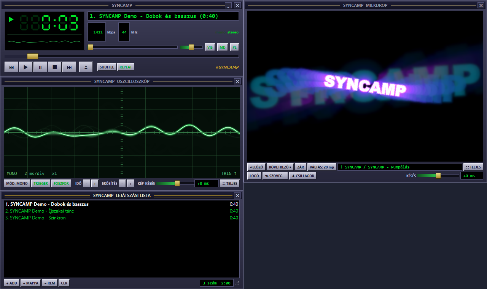
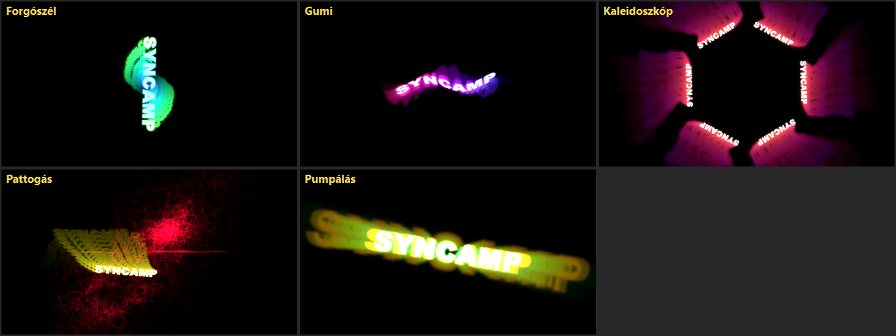
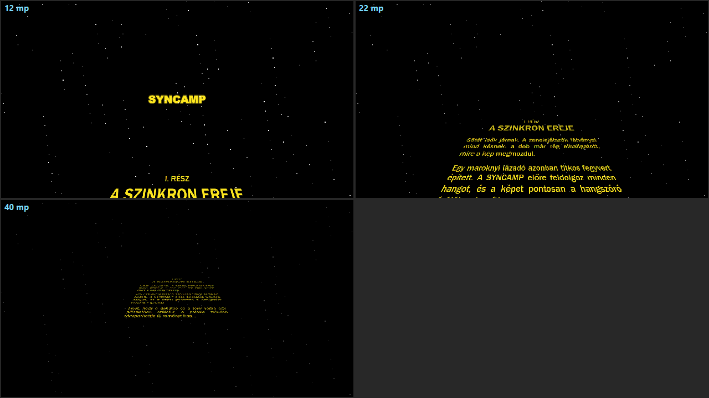

# SYNCAMP

**Winamp-stílusú zenelejátszó Windowsra, ahol a látvány pontosan a hanggal együtt mozog.**

A régi Winamp vizualizációi gyakran késnek: a dob már rég elszólt, mire a kép megmozdul.
A SYNCAMP ezt úgy oldja meg, hogy:

1. a számot lejátszás előtt **teljesen feldolgozza** a memóriába,
2. a hangkártyától minden hangdarabnál megkérdezi, **pontosan mikor szólal meg** a hangszóróban,
3. a képet mindig ahhoz a hangmintához rajzolja, ami **éppen most hallható**.

Így a dobütés és a látvány egy pillanatban történik. A maradék eltérést
(például Bluetooth fejhallgatónál) csúszkával ezredmásodpercre be lehet állítani.

## Mit tud?

- **Winamp-szerű kezelés:** LED-es időkijelző, gördülő számcím, hangerő, balansz, keverés, ismétlés,
  lejátszási lista behúzással, mappák hozzáadásával. A Winamp gyorsbillentyűi is működnek.
- **Különálló ablakok, mint a Winampban:** főablak, oszcilloszkóp, MilkDrop, lejátszási lista.
  Mindegyik méretezhető, leválasztható, mágnesesen tapad, és a főablakkal együtt mozog.
- **Oszcilloszkóp:** klasszikus zöld foszforos kijelző. Mono, bal+jobb vagy XY (Lissajous)
  módban, triggerrel, utánvilágítással.
- **MilkDrop-látványok** a [projectM](https://github.com/projectM-visualizer/projectm) segítségével,
  közel 9800 látvánnyal. Winamp és pluginok nélkül működik.
- **Saját, szerkeszthető feliratos látványok:** Pumpálás, Forgószél, Pattogás, Kaleidoszkóp, Gumi.
  A felirat bármi lehet, hosszú is, a program magától tördeli.
- **Csillagok háborúja-stílusú futó szöveg:** kék bevezető sor, zsugorodó cím, majd a
  perspektívában a távolba kúszó sárga szöveg. Minden része szerkeszthető.
- **Teljes képernyő** dupla kattintással bármelyik látványablakon (Esc: vissza).
- MP3, FLAC, WAV, OGG lejátszás, ékezetes fájlnevekkel is.

## Telepítés

Kell hozzá: **Windows 10/11 (64 bit)** és **Python 3.10–3.13**
([python.org](https://www.python.org/downloads/)).

1. Töltsd le a tárolót (zöld **Code** gomb → **Download ZIP**), és csomagold ki.
2. Futtasd a **`setup.bat`** fájlt. Ez létrehozza a Python-környezetet, telepíti a csomagokat,
   és letölti a MilkDrop-látványcsomagot (kb. 35 MB).
3. Indítás: **`Syncamp.bat`**

## Kezelés

| Billentyű | Mit csinál |
|---|---|
| **X** / **C** / **V** | Lejátszás / Szünet / Stop |
| **Z** / **B** | Előző / Következő szám |
| **L** | Fájlok megnyitása |
| **← →** | Tekerés 5 mp-cel |
| **↑ ↓** | Hangerő |
| **Szóköz** | Szünet / folytatás |
| **M** | MilkDrop ablak ki/be |
| **N** | Új MilkDrop-látvány |
| **F** | Teljes képernyő (MilkDrop, ha látszik, különben a szkóp) |
| **Esc** | Kilépés a teljes képernyőből |

- **Szinkron hangolása:** a szkóp **KÉP-KÉSÉS** és a MilkDrop **KÉSÉS** csúszkája.
  Jobbra (+) húzva később, balra (−) húzva korábban mozdul a kép. Dupla kattintás: nulla.
- **Feliratok:** MilkDrop ablak → **✎ SZÖVEG…**
- **Csak a feliratos látványok:** **LOGÓ** gomb. **Futó szöveg:** **★ CSILLAGOK** gomb.

## Hogyan működik?

| Fájl | Szerep |
|---|---|
| `engine.py` | Dekódolás (miniaudio), lejátszás (sounddevice / WASAPI), a „most hallható” óra |
| `scope.py` | Oszcilloszkóp |
| `milkdrop.py` | projectM-kötés (ctypes), a hang etetése képkockánként a pontos óra szerint |
| `vizgen.py` | Feliratképek és a saját MilkDrop-látványok előállítása |
| `windows.py` | Winamp-szerű ablakok: tapadás, együtt mozgás, méretezés |
| `syncamp.py` | A program, a felület |

A szinkron lényege az `engine.Player.heard()`: a PortAudio minden hangblokknál megadja,
mikor ér a blokk a hangszóróhoz (`outputBufferDacTime`). Ebből a pillanatnyi órával
visszaszámolható, melyik minta szól éppen. Minden látvány ezt kérdezi le rajzolás előtt.

## Felhasznált programok és licencek

- **projectM 4.1.8** (LGPL-2.1): `milkdrop/projectM-4.dll`, licenc: `milkdrop/projectM-LICENSE.txt`.
  A DLL egy kicsit módosított változatból készült, a változtatás a
  `milkdrop/projectM-4.1.8-syncamp.patch` fájlban van. A projectM a Qt-ablak saját képpufferébe
  rajzol, és egy hiányzó `#include` is bekerült. Fordítás: a projectM forrása
  + a patch, CMake, Visual Studio, GLEW.
- **GLEW 2.2.0**: `milkdrop/glew32.dll`, licenc: `milkdrop/GLEW-LICENSE.txt`.
- **MilkDrop-presetek és -textúrák:** a projectM
  [Cream of the Crop](https://github.com/projectM-visualizer/presets-cream-of-the-crop) és
  [texture pack](https://github.com/projectM-visualizer/presets-milkdrop-texture-pack) csomagja.
  Ezeket a `setup.bat` tölti le, a tárolóban nincsenek benne.
- **Python-csomagok:** PySide6 (Qt), sounddevice (PortAudio), miniaudio, NumPy.

A SYNCAMP-ot Claude (Anthropic) segítségével készítettem.
